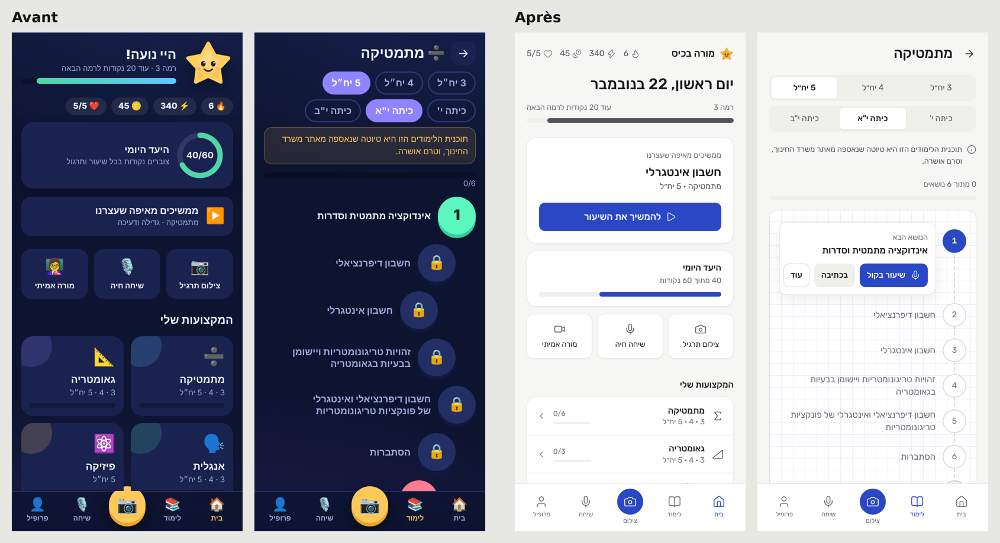
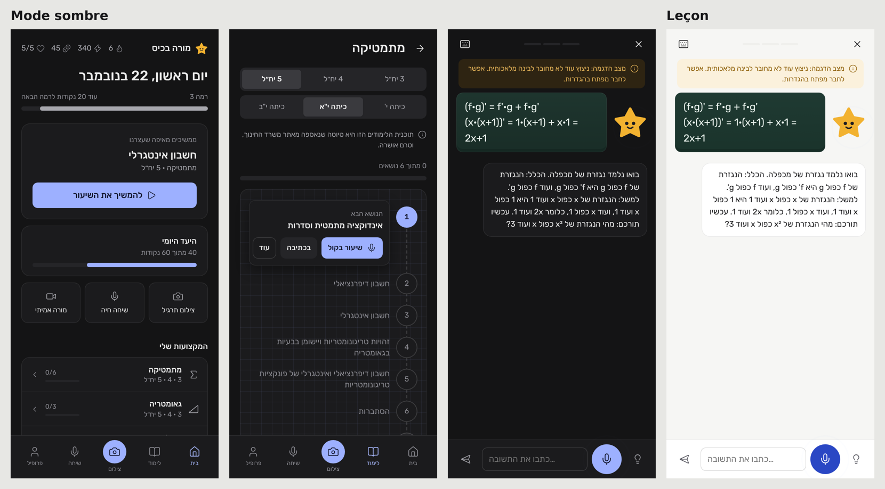
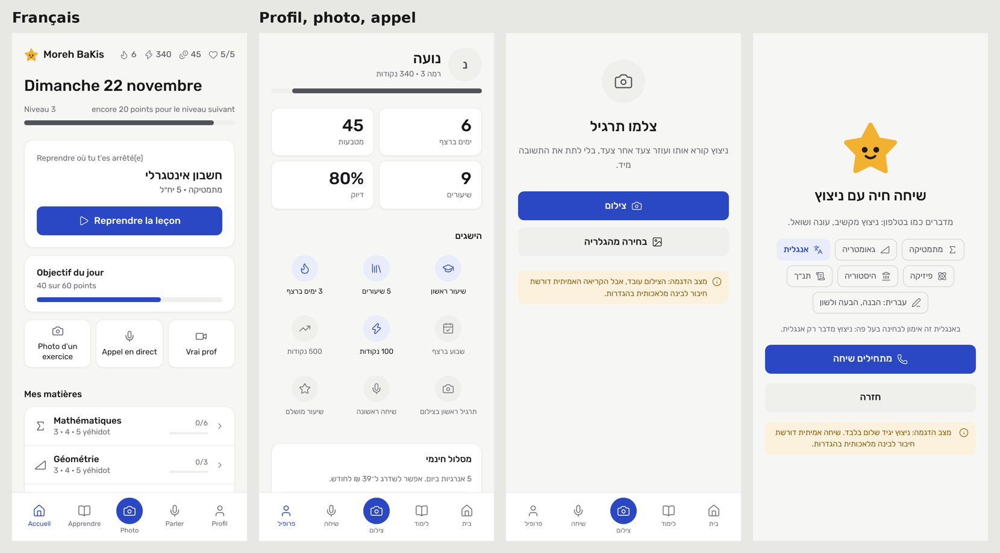

# Refonte visuelle de l'appli (méthode unslop)

Demande de Gabriel du 22 novembre 2026 : redessiner l'appli avec unslop pour la rendre plus professionnelle et plus intuitive.

**Statut : validée par Gabriel le 22 novembre 2026 et appliquée à toute l'appli le même jour** (thème clair par défaut, sombre si le téléphone l'est ; ניצוץ à plat, logo et voix).

Méthode : [unslop](https://github.com/heydamir/unslop), de Damir Sokolovsky ([@heydamir](https://x.com/heydamir)), licence CC BY 4.0.
On garde toutes les fonctions, tous les contenus et l'ordre des écrans. On change les tailles, les couleurs, les mots et les icônes, pour qu'ils soient choisis plutôt que laissés par défaut.

## 1. Ce qui faisait « appli générée » avant la refonte (audit)

- **Couleurs** :
  - fond bleu nuit avec deux taches violettes floues derrière tout (`body` dans `css/app.css`) ;
  - quatre couleurs vives pour les boutons (menthe, violet, jaune, corail), plus une couleur par matière ;
  - un cercle décoratif sur chaque carte de matière et une barre de niveau en dégradé.
- **Emojis à la place des icônes**, sur presque tous les écrans :
  - barre du bas (🏠 📚 📷 🎙️ 👤) et matières (➗ 📐 🗣️ ⚛️ 🏛️ 📖 ✍️) ;
  - compteurs (🔥 ⚡ 🪙 ❤️) et badges (🎓 🌋 🚀…) ;
  - boutons de leçon (🎙️ ⌨️ 🧩 👩‍🏫), cadenas 🔒, coffre 🎁 et écran de démarrage ⭐.
- **Typographie** : aucune police hébraïque n'est chargée (police du système), et les titres sont en 800-900, du gras partout.
- **Textes** : exclamations et emojis dans l'interface, par exemple « שלום! אני ניצוץ ✨ », « היי נועה! », « יוצאים לדרך! », « עליתם לרמה {n}! 🎉 ».
- **Boutons et formes** : effet 3D (ombre colorée sous chaque bouton) et pastilles très arrondies partout. Le bouton photo jaune déborde de la barre du bas.
- **Mouvement** : l'étoile flotte en boucle, le thème en cours et le micro pulsent, confettis.
- **Espacements** : des valeurs hors grille (5, 6, 9, 13, 14, 22 px) et cinq rayons d'angle différents (13 à 20 px).
- **Intuitivité** :
  - sur l'accueil, cinq zones ont le même poids et l'action principale (reprendre la leçon) ne ressort pas ;
  - sur le parcours d'une matière, le zigzag cache où l'on en est (« 0/6 » en petit).

## 2. Direction

- **Produit** : ניצוץ, un prof particulier à la voix, dans le téléphone, qui fait réviser le bagrout (3, 4 ou 5 yéhidot) et la première année de fac, en hébreu.
- **Caractère** : patient, précis, complice.
- **Monde** : le cahier à petits carreaux et le stylo bleu de l'élève, le stylo rouge du prof, le tableau vert de la classe.
- **Moments forts** (les seuls endroits riches en couleur et en détail) :
  1. le parcours d'une matière, tracé sur papier à petits carreaux, thème par thème du programme officiel ;
  2. le tableau de la leçon, où ניצוץ écrit les formules à la craie.
- **Signature** : la coche du prof, tracée à la main, partout où quelque chose est acquis (thème terminé, réponse juste, objectif du jour atteint).

## 3. Choix concrets

- **Couleurs** :
  - gris neutre pour les fonds et les cartes, trois teintes de texte (principal, secondaire, discret) ;
  - un seul accent, le bleu d'encre (#2a47c4), réservé à l'action principale, à la sélection et au thème en cours ;
  - le rouge du prof seulement pour les erreurs, le vert seulement pour ce qui est juste.
- **Thème** : clair par défaut, sombre automatiquement si le téléphone est en mode sombre (même structure, couleurs adaptées).
- **Police** : Rubik (hébreu et latin, licence OFL), en 400, 500 et 600, hébergée dans le dépôt et non chez Google : rien n'est envoyé à un tiers et l'appli marche hors ligne.
- **Icônes** : un seul jeu d'icônes au trait ([Lucide](https://lucide.dev), licence ISC), une taille, une épaisseur, inclus dans l'appli. Plus aucun emoji dans l'interface.
- **ניצוץ** : redessiné à plat (étoile pleine, sans dégradé ni lueur). Il devient le logo, et ne s'anime que quand il parle (leçon à la voix, appel).
- **Jeu** : points, série de jours, énergie, coffre et badges restent, mais en chiffres discrets avec une icône au trait, au lieu de pastilles colorées.
- **Accueil** :
  - la date comme titre, au lieu de « היי נועה! » ;
  - la reprise de la leçon devient l'action principale, avec un seul gros bouton ;
  - les matières passent en liste, avec leur avancement.
- **Parcours** : les thèmes sur une ligne verticale, la coche pour les thèmes faits, le thème en cours ouvert avec ses deux actions (leçon à la voix, leçon écrite).
- **Boutons** : à plat, 48 px de haut pour les actions principales, angles de 10 px (16 px pour les cartes). Les espacements sont tous des multiples de 4 px.
- **Mouvement** : plus d'animation en boucle. Il reste un changement de couleur au toucher et une légère pression. Les confettis restent seulement pour une vraie réussite (badge, niveau).

## 4. Fichiers touchés

- `css/app.css` (réécrit), `index.html` (couleur du thème, police) ;
- `js/ui.js` (icônes, ניצוץ à plat), `js/main.js` (barre du bas) ;
- `js/views/*.js` (emojis → icônes) ;
- `i18n/he.json` et `i18n/fr.json` (textes sans exclamation ni emoji, mêmes clés) ;
- un dossier `fonts/` (Rubik) et un fichier d'icônes.

Ces fichiers avaient en grande partie été écrits par Hermes ; Gabriel a accepté qu'ils soient réécrits.
Aussi touchés : `js/icons.js` (nouveau), `fonts/` (nouveau), `js/curriculum.js` et `js/game.js` (icônes des matières et des badges), `manifest.webmanifest`, `icons/` et `scripts/make-icons.mjs` (icône de l'appli : ניצוץ à plat sur le bleu d'encre).

## 5. Ce qui a été fait (22/11)

- Tous les écrans, en hébreu et en français :
  - accueil, apprentissage, parcours d'une matière, leçon, quiz ;
  - photo d'exercice, appel, vrai prof ;
  - profil, rapport pour les parents, réglages, faculté, première ouverture.
- Plus aucun emoji dans l'interface (vérifié par un script sur tout le code).
- Plus aucun « ! » dans les textes. Les gains de points sont écrits en mots (« קיבלתם 18 נקודות »), pour que le « + » ne passe pas du mauvais côté en hébreu.
- Clés de texte ajoutées dans les deux langues ; `node scripts/check-i18n.mjs` : tout est cohérent.
- Classes en français : « Première », avec la lettre hébraïque dessous (décision du 10/11 respectée).
- Confettis gardés seulement pour un nouveau niveau et un nouveau badge.
- Sur ordinateur, l'appli garde une largeur de téléphone, centrée.
- Vérifications :
  - `node --test scripts/test-*.mjs` : 52 tests réussis ;
  - parcours complet dans un navigateur de téléphone simulé (première ouverture, leçon jusqu'aux étoiles, quiz jusqu'au score, photo et indices, appel, réservation d'un prof, réglages en français, faculté, rapport parents) : aucune erreur ;
  - captures de chaque écran en clair, en sombre et en français.

## 6. Reste à faire

- Essai sur le vrai iPhone de Gabriel (police, mode sombre, barre du bas avec l'encoche).
- L'icône de l'appli a changé : sur un téléphone où l'appli est déjà installée, il faut la retirer de l'écran d'accueil et la réinstaller pour voir la nouvelle.

## Maquette

`docs/refonte/maquette/` contient la source des deux écrans de la proposition (accueil et parcours).
Pour la régénérer :
1. dans `docs/refonte/`, lancer `npm i @fontsource/rubik lucide-static` ;
2. puis `node maquette/build.js`.
